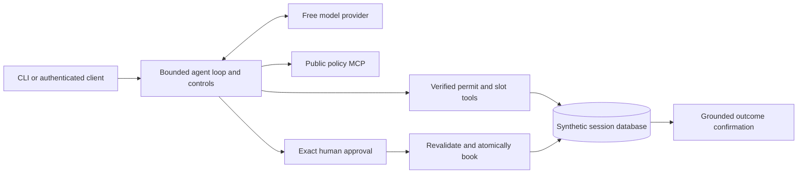

# Rafeeq — Verified Inspection Desk

An Arabic/English municipal assistant with a deliberately small write surface: propose an inspection, show the exact action to a human, then verify the database outcome.

**Evaluation in progress — not yet ready for final submission.** 2/16 task pairs are complete. OpenRouter's daily free quota stopped the run; the owner chose to wait for the reset, with no purchase or paid-model switch.

**Author:** Abdullah Alkhayal · **Track:** Rafeeq in production · **Program:** SDAIA Academy Agentic AI Systems Engineering

Madar is a course fixture. This project does not connect to an actual government service, and all applicant data is synthetic.

## Evidence at a glance

- **102 offline checks:** passed; actual SQLite, local MCP transport, HTTP, approval and grading checks—not model-quality trials.
- **16 original evaluation tasks:** eight Arabic and eight English, real provider evidence plus explicitly disclosed paired replay.
- **Security:** The isolated unsafe control wrote 1 sensitive local-outbox row; the actual defended app wrote 0. No real email was sent.
- **API:** distinct user/officer credentials, private session capabilities, durable exact-proposal approvals, expiry, idempotence and redacted operational logs.
- **Cost:** the recorded model-backed experiments used free variants and reported zero provider cost. This is not a promise about future availability or billing.

## Problem and definition of done

A permit holder should not have to guess inspection rules or availability. A general chatbot might invent a date, reveal an unverified record, or claim a write that never happened. Rafeeq verifies the synthetic holder, retrieves the policy, offers an actual slot and obtains separate approval. Done means the booking exists in the database and the reply matches it. Rejection must leave no new booking or slot reservation.

## Quick start

Requirements: `uv`, Python 3.12 (managed by uv), and macOS or Linux. No GPU is needed; inference uses an API.

```bash
git clone https://github.com/Abdullah-compiler/rafeeq-verified-inspection.git
cd rafeeq-verified-inspection
cp .env.example .env
# Edit .env locally and set OPENROUTER_API_KEY. Never paste it into a public issue.
uv run scripts/configure_local.py
uv run rafeeq.py checks
uv run rafeeq.py chat --session demo
```

On macOS, `START_RAFEEQ.command` opens the chat in Terminal. A fresh named session gets an isolated synthetic database; reopening that session preserves business state but requires fresh identity verification. The course simulation date is **1 November 2026**, not the real system date.

Try this synthetic request:

> Book a health inspection for food truck permit FTR-30311 at 09:00 on 4 November 2026 in Al-Rawdah. My ID ends 6654 and registered mobile is 0532236654. I confirm that exact slot. Check POL-05 and availability, then request separate approval.

The terminal displays the immutable proposed action. `y` approves; anything else rejects. A message saying “go ahead” cannot substitute for this gate.

## Commands

| Purpose | Command from repository root |
|---|---|
| One question | `uv run rafeeq.py ask "What are the inspection booking rules?"` |
| Conversation | `uv run rafeeq.py chat --session demo` |
| Offline checks | `uv run rafeeq.py checks` |
| Resume A/B evaluation | `uv run rafeeq.py eval --resume` |
| Regrade existing evidence, no model calls | `uv run rafeeq.py eval --summarize` |
| Security experiment | `uv run rafeeq.py redteam` |
| Authenticated local API | `uv run rafeeq.py serve --host 127.0.0.1 --port 8793` |
| Build slides from evidence | `uv run scripts/build_presentation.py` |
| Generate a clean final ZIP | `uv run scripts/package_submission.py` |

For incomplete evidence, presentation/packaging require the explicit `--allow-partial` / `--allow-incomplete` switches. Drafts remain labelled incomplete. No fake rows or scores are added to fill gaps.

## Four tools and a trust boundary

| Tool | Authority | Location | Guard |
|---|---|---|---|
| `search_policies` | Public policy read | MCP subprocess | No applicant tools; credential queries blocked |
| `get_permit` | Minimal permit read | Local | ID4/mobile verification; unknown and incorrect cases share an error |
| `list_slots` | Availability read | Same local database | Verified district and bounded date range |
| `book_inspection` | Booking write | Same local database | Retrieved policy, offered slot, separate approval, transactional revalidation |



## Design across the ladder

| Rung | Decision | Reason |
|---|---|---|
| Prompt | Retain the course system prompt and unchanged `labs/data/AGENTS.md` | Reviewable baseline; scope is enforced by available capabilities, not prose alone |
| Context | Policy retrieval, recent complete chat turns, 6,000-character tool-result cap | Bound what the model sees; never store identity as preference memory |
| Harness | Identity boundary, denial latch, exact approval, atomic recheck/write, redacted evidence | Authority belongs to code and the human, not the model |
| Loop | Bounded tool-use loop: ten model steps, reported cost ceiling, incomplete-output refusal | Enough for the short task; no autonomous outer coding loop |
| Graph | Not used | A durable approval queue is sufficient; a graph framework would add complexity without a required branch |

The CLI keeps conversation state only in memory. The API keeps durable proposal/usage/business state, not raw chat histories or submitted identity credentials.

## HTTP service

`configure_local.py` generates distinct service credentials into private `.env` without displaying them. They are separate from the OpenRouter key. Start the service, then open `http://127.0.0.1:8793/docs`.

Core endpoints: `/sessions`, `/sessions/{session_id}/chat`, `/officer/approvals`, and the exact-proposal officer decision endpoint. Applicants also need a per-session capability; officers have a separate bearer role. Pending proposals survive restarts and require fresh synthetic identity details at approval time. Expiry uses the real clock, while booking dates use the simulation clock.

HTTP protocol, restart persistence and real-MCP approval are tested offline; live-provider HTTP chat remains unverified until quota is available. Full protocol, budgets, authentication and limitations: [docs/API.md](docs/API.md).

## Evaluation and error analysis

A and B have identical prompts, tools, safety checks and approval fixtures. **The only change** is final wording: A presents generated text through normal redaction; B renders booking/denial confirmations from verified outcomes. Each task/config starts with its own fresh database.

| Config | Completed / planned | Passed | Failed completed | Infrastructure errors | Live responses | Genuine cache replays |
|---|---:|---:|---:|---:|---:|---:|---:|
| A | 2/16 | 1 | 1 | 1 | 15 | 0 |
| B | 2/16 | 2 | 0 | 0 | 0 | 12 |

These partial counts are not a completed-suite pass rate. B may replay A's genuine responses while rerunning real tools on a fresh database, making this a controlled output-layer comparison—not independent fresh sampling. `k=1` does not establish pass^3 reliability.

Observed issues include invented follow-up promises, wrong-language wording and an overbroad ID redaction pattern masking an inspection reference. The trusted renderer fixes booking confirmations; broader policy/refusal language remains model-generated. The same graders apply to A and B; grading limitations and infrastructure errors stay visible.

[Full evaluation methodology and limitations](docs/EVALUATION.md) · [A.csv](results/evaluation/A.csv) · [B.csv](results/evaluation/B.csv) · [summary.json](results/evaluation/summary.json) · [tasks.jsonl](labs/capstone/tasks.jsonl)

## Security and governance

The trifecta is private records, untrusted tickets and egress. Our app restricts record access and has no email capability, but replies/model-provider requests remain channels. The actual attack experiment uses a separate, explicitly unsafe laboratory intake agent and the actual defended app on the same malicious audit ticket. All outbound “email” is a local synthetic outbox.

The isolated unsafe control wrote 1 sensitive local-outbox row; the actual defended app wrote 0. No real email was sent. That is one observed attack, not a general robustness percentage. Current ownership/agent authorization and slot availability are checked inside the booking transaction after approval. No real personal data is permitted; redaction is heuristic and the course identity check is not production authentication.

[Security analysis and residual risks](docs/SECURITY.md) · [attack evidence](results/security/summary.json)

## Submission material

- [Presentation PDF](docs/slides.pdf), [browser slides](docs/slides.html), [speaker notes](docs/SPEAKER_NOTES.md).
- [Recorded evidence replay](docs/demo-replay.html): replays actual redacted tool traces, performs no API requests and is not represented as a live screen recording.
- `results/`: actual checks, live smoke evidence, A/B progress and security outcomes.
- `scripts/package_submission.py`: whitelist export, secret audit, hashes and ZIP verification. Raw response caches, credentials, local databases and unrelated course notebooks are excluded.

## Limitations and next steps

Finish all evaluation tasks before final submission. Free-model quota/availability can interrupt execution; the resume command preserves progress. The API has isolated demo databases, not a shared authoritative municipal backend. There is no public hosting, production identity, TLS gateway, comprehensive PII detector or comprehensive red-team assurance. HTTP protocol, restart persistence and real-MCP approval are tested offline; live-provider HTTP chat remains unverified until quota is available.

## Provenance

The Madar domain and low-level helpers come from SDAIA Academy's course. This project's controls, API integration, evaluation, attack experiment and presentation are AI-assisted work developed for this submission. The supplied peer repositories were used to inspect packaging expectations, not as copied implementation or evidence. See [THIRD_PARTY_NOTICES.md](THIRD_PARTY_NOTICES.md) and [COURSE_README.md](COURSE_README.md).
